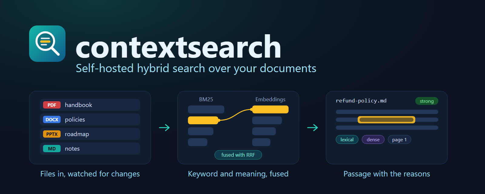
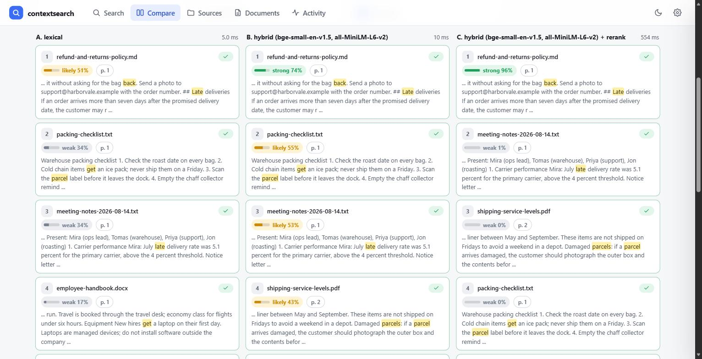
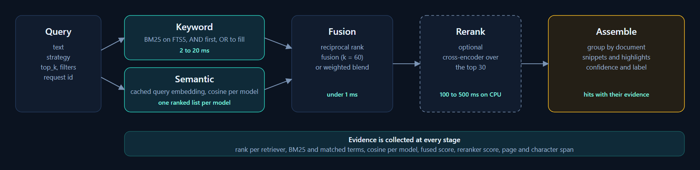
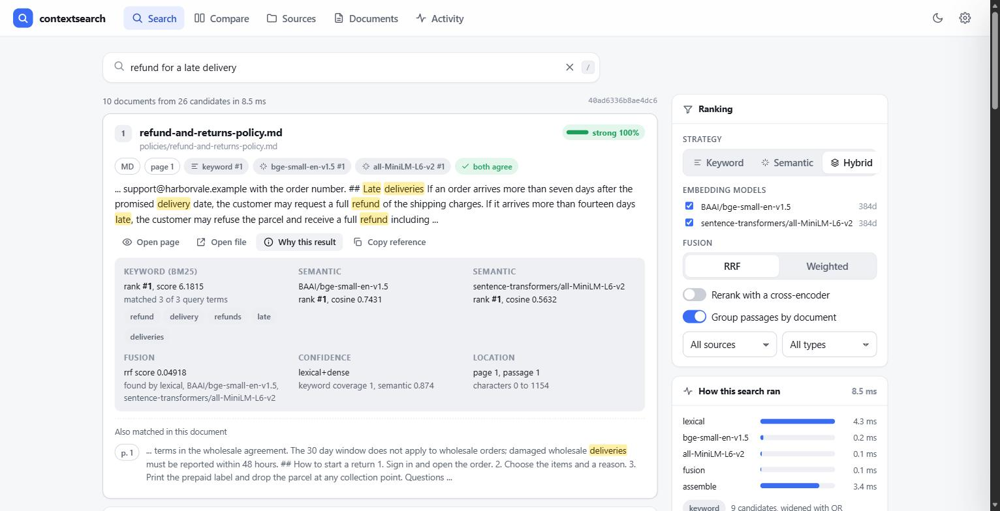
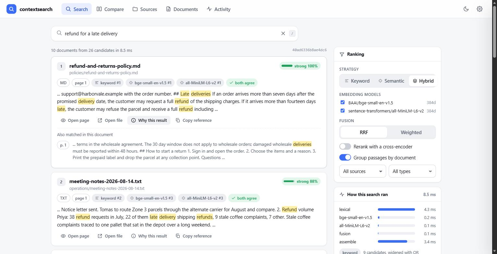
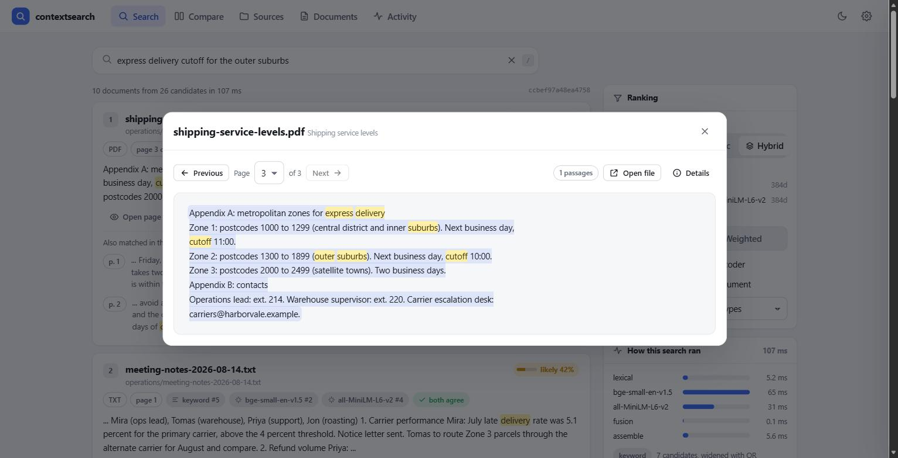
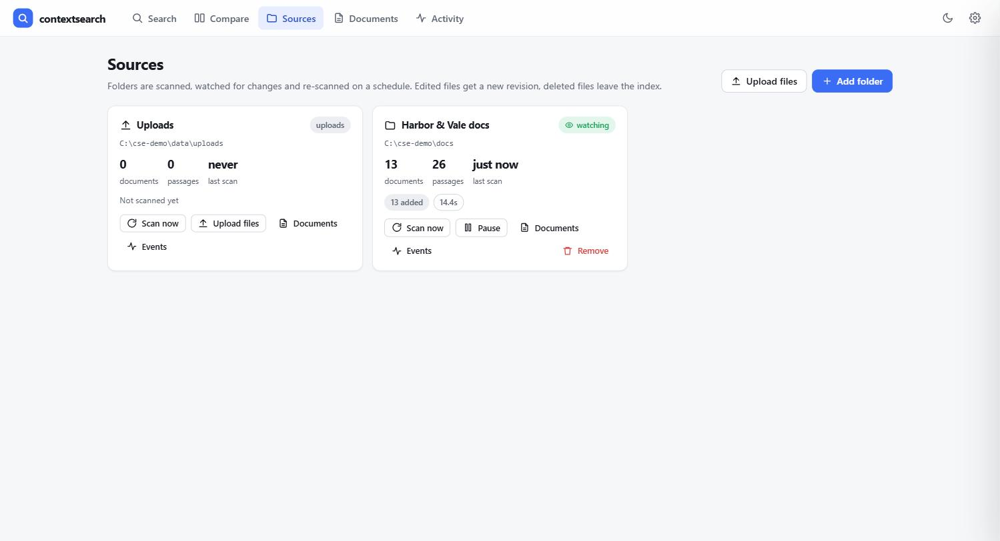
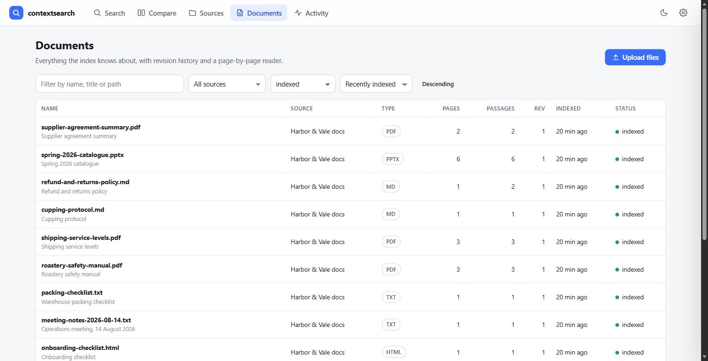
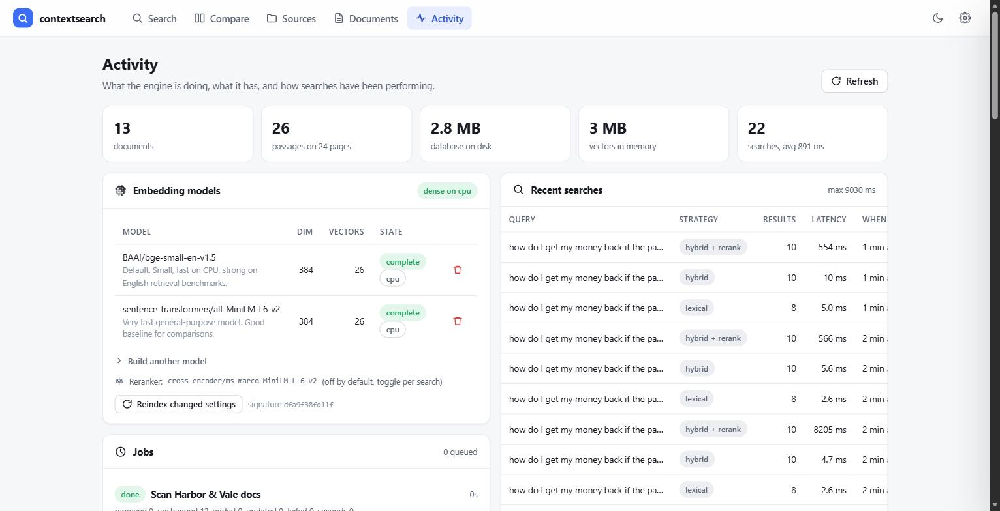
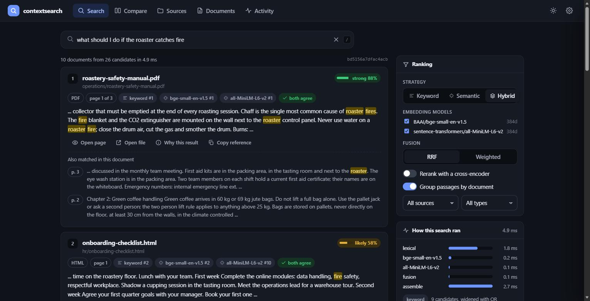

# contextsearch

[](https://github.com/inboxpraveen/context-search-engine/actions/workflows/ci.yml)
[](https://github.com/inboxpraveen/Context-Search-Engine/releases)
[](pyproject.toml)
[](LICENSE)

contextsearch is a self-hosted search engine for your own documents. Point it at a folder of PDFs, Word and PowerPoint files, text, Markdown or HTML, and it indexes them, watches them for changes and answers queries with the page, the exact passage and the reasons a result ranked where it did. It combines keyword search (BM25) with semantic search (embeddings), fuses the two, and can rerank the top candidates with a cross-encoder. There is no language model rewriting anything: what you see is what the retrieval found.

<p align="center">
  
</p>

## What it does

- Indexes PDF, DOCX, PPTX, TXT, Markdown, HTML, CSV and a few more text formats. With the OCR extra it also reads scanned PDF pages and images.
- Watches folders. New files are indexed within seconds, edited files get a new revision, deleted files leave the index. A periodic rescan catches anything the file system events miss, including network shares.
- Searches three ways: `lexical` (BM25 on SQLite FTS5), `dense` (any sentence-transformers model, several at once if you like) and `hybrid` (both, fused with reciprocal rank fusion). Reranking with a cross-encoder is a toggle.
- Explains every result: which retrievers found it and at what rank, which query terms matched, the cosine similarity per model, the reranker score, a confidence label, the page and character span in the source, and per-stage timings for the request.
- Compares strategies side by side in the UI, and scores them on your own labelled queries with `contextsearch eval` (recall, MRR, nDCG, latency).
- Runs as one process with one SQLite file. No external services. Keyword search works with zero heavy dependencies; the dense extra adds torch and sentence-transformers.
- Ships with a web UI (light and dark, no build step, no CDN), a REST API with an OpenAPI page, a CLI, JSON logs with request ids, Prometheus metrics, API key auth, a folder allow-list, a Dockerfile and a compose file.

<p align="center">
  
</p>

## Quick start

```bash
git clone https://github.com/inboxpraveen/context-search-engine.git
cd context-search-engine
python -m venv .venv && . .venv/bin/activate      # Windows: .venv\Scripts\activate
pip install -e ".[dense]"                          # keyword + semantic search

contextsearch doctor                               # checks Python, SQLite FTS5, torch, the model cache
contextsearch serve                                # UI and API at http://127.0.0.1:8080
```

On Linux, `pip install` pulls the CUDA build of torch (several GB) unless you install the CPU build first: `pip install torch --index-url https://download.pytorch.org/whl/cpu`. Conda users can do the same inside any environment; `pip install -e .` alone gives keyword search with no torch at all.

The first search downloads the default embedding model (`BAAI/bge-small-en-v1.5`, about 130 MB) into the Hugging Face cache. After that everything works offline.

Try it on the bundled examples:

```bash
contextsearch index examples/sample-docs                       # scans, chunks, embeds; prints a summary
contextsearch search "how do I get my money back" --strategy hybrid
contextsearch eval examples/labels.json --strategies lexical,dense,hybrid,hybrid+rerank
```

Or open the UI, go to Sources, add a folder, and start typing.

## How a search works

<p align="center">
  
</p>

1. The query goes to FTS5 as a keyword search (stemmed, quoted phrases kept, common words dropped) and to each embedding model as a vector. Each retriever returns its top candidates.
2. The candidate lists are fused. Reciprocal rank fusion is the default: it needs no score calibration and a chunk both retrievers like reliably rises to the top.
3. Optionally, a cross-encoder reads the query together with each of the top candidates and rescores them. This is the most precise stage and the most expensive one, so it is off by default and a toggle in the UI.
4. Chunks are grouped by document, snippets are cut around the matches, and every hit gets a confidence in 0 to 1 with a label (strong, likely, weak).

[docs/SEARCH.md](docs/SEARCH.md) covers the strategies, the fusion maths, how confidence is computed and how to calibrate it, and which models to pick.

## What a result looks like

<p align="center">
  
</p>

Abbreviated from a real response on the bundled examples (`text`, `also_matched` and a few fields left out):

```json
{
  "rank": 1,
  "score": 0.032787,
  "confidence": 1.0, "confidence_label": "strong",
  "document": {"id": "5b1f...", "filename": "refund-and-returns-policy.md", "relpath": "policies/refund-and-returns-policy.md", "revision": 1, "pages": 1},
  "page": 1, "char_start": 0, "char_end": 1154,
  "snippet": "... support@harborvale.example with the order number.  ## Late deliveries  If an order arrives more than seven days after the promised delivery date, the customer may request a full refund ...",
  "highlights": [[57, 61], [62, 72], [128, 136], [178, 184]],
  "evidence": {
    "found_by": ["lexical", "dense:BAAI/bge-small-en-v1.5"],
    "agreement": true,
    "lexical": {"rank": 1, "bm25": 6.509, "matched_terms": ["refund", "delivery", "refunds", "late", "deliveries"], "covered_terms": ["refund", "late", "delivery"], "query_terms": 3},
    "dense": {"BAAI/bge-small-en-v1.5": {"rank": 1, "cosine": 0.7431}},
    "fused_score": 0.032787, "fusion": "rrf",
    "confidence_parts": {"lexical_coverage": 1.0, "dense_similarity": 0.874, "source": "lexical+dense"},
    "locator": {"page": 1, "char_start": 0, "char_end": 1154, "chunk_index": 0}
  }
}
```

The response also carries `timings` per stage, the `request_id` that appears in the server log, and any `warnings` (for example when hybrid ran as keyword search because no dense index exists yet). `GET /api/v1/documents/{id}/pages/1` returns the page text, so `char_start` and `char_end` point at the exact passage; the UI opens it highlighted.

## Screenshots

| | |
|---|---|
|  Results grouped by document, with page, matched terms and a confidence label |  The viewer opens the page with the exact passage and the query terms marked |
|  Watched folders with scan summaries |  Every document with pages, passages and revisions |
|  Models, jobs, recent searches, events and health |  The same search in the dark theme |

## Documentation

| Document | Covers |
|---|---|
| [docs/ARCHITECTURE.md](docs/ARCHITECTURE.md) | components, the index layout, how folder sync and revisions work, jobs |
| [docs/SEARCH.md](docs/SEARCH.md) | strategies, fusion, reranking, confidence, choosing and comparing models |
| [docs/API.md](docs/API.md) | every endpoint with examples (interactive version at `/docs`) |
| [docs/CONFIGURATION.md](docs/CONFIGURATION.md) | all `CSE_*` settings, profiles, derived paths |
| [docs/DEPLOYMENT.md](docs/DEPLOYMENT.md) | production checklist, Linux and Windows, Docker, systemd, nginx, upgrading from 2.x |
| [docs/PERFORMANCE.md](docs/PERFORMANCE.md) | memory and latency numbers, sizing, what to tune |
| [docs/EXTENDING.md](docs/EXTENDING.md) | using contextsearch as a library, adding readers, embedders and rerankers |
| [docs/TROUBLESHOOTING.md](docs/TROUBLESHOOTING.md) | symptoms, causes and fixes |
| [docs/ROADMAP.md](docs/ROADMAP.md) | what comes next (image embeddings, audio, PostgreSQL) |
| [CHANGELOG.md](CHANGELOG.md), [CONTRIBUTING.md](CONTRIBUTING.md), [SECURITY.md](SECURITY.md) | |

## CLI

```
contextsearch serve      [--host H] [--port P] [--profile development|production]
contextsearch index      PATH [--name N] [--no-recursive] [--include pdf,docx] [--exclude GLOBS]
contextsearch sync       [SOURCE_ID]
contextsearch search     QUERY [--strategy lexical|dense|hybrid] [--model M] [--rerank] [--top-k N] [--json]
contextsearch sources | documents [--q TEXT] | models | stats
contextsearch build      MODEL          build a dense index for another embedding model
contextsearch drop       MODEL
contextsearch reindex    [--force]      re-chunk after changing the chunking settings
contextsearch eval       LABELS.json [--strategies lexical,hybrid,hybrid+rerank] [--k 10]
contextsearch doctor
contextsearch config     [--markdown | --json]
contextsearch db         check | vacuum | optimize
```

Every command accepts `--data-dir`, `--profile` and `--log-level`. `python -m contextsearch` works too.

## REST API

Everything the UI does goes through the API under `/api/v1`; the interactive reference is served at `/docs`. Set `CSE_API_KEY` to require a key, sent as `X-API-Key` or `Authorization: Bearer`. Errors are JSON with `error`, `code`, `status`, `details` and `request_id`.

```bash
curl "http://localhost:8080/api/v1/search?q=refund+for+a+late+delivery&strategy=hybrid&top_k=5" -H "X-API-Key: change-me"

curl -X POST http://localhost:8080/api/v1/sources -H "X-API-Key: change-me" \
     -H "Content-Type: application/json" -d '{"path": "/srv/docs", "name": "Shared drive"}'

curl -F "files=@handbook.pdf" http://localhost:8080/api/v1/documents/upload -H "X-API-Key: change-me"
```

## As a library

```python
from contextsearch import Engine

with Engine.open("./data", embedding_models="BAAI/bge-small-en-v1.5") as engine:
    source, job = engine.add_folder("/srv/docs")
    job.wait()
    for hit in engine.search("refund for a late delivery", strategy="hybrid", top_k=5).hits:
        print(hit.confidence_label, hit.document.relpath, "page", hit.chunk.page, hit.snippet)
```

`Engine` owns the database, the models, the background worker and the folder watcher. Pass `configure_logs=False` if your application sets up logging itself. [docs/EXTENDING.md](docs/EXTENDING.md) has the full library tour.

## Good to know

- One process. The vector indexes and the watcher live in memory, so run a single `contextsearch serve` (or one uvicorn worker) per data folder. It serves searches from a thread pool while indexing runs in the background.
- Memory is roughly `chunks x dimension x 4 bytes` per embedding model: 100k chunks with a 384-dimension model is about 150 MB. [docs/PERFORMANCE.md](docs/PERFORMANCE.md) has the table.
- The data folder holds one SQLite file (documents, pages, chunks, vectors, history) plus uploads and logs. Back it up by copying the folder.
- Everything runs on your machine. Nothing is sent anywhere, and after the first model download it works without internet access.

## Contributing

Bug reports, fixes and new readers or embedders are welcome. [CONTRIBUTING.md](CONTRIBUTING.md) explains the setup, the tests and the writing conventions. If contextsearch runs in your team's workflow, sponsoring the project through the Sponsor button on GitHub helps keep it maintained.

## License

MIT. See [LICENSE](LICENSE).
